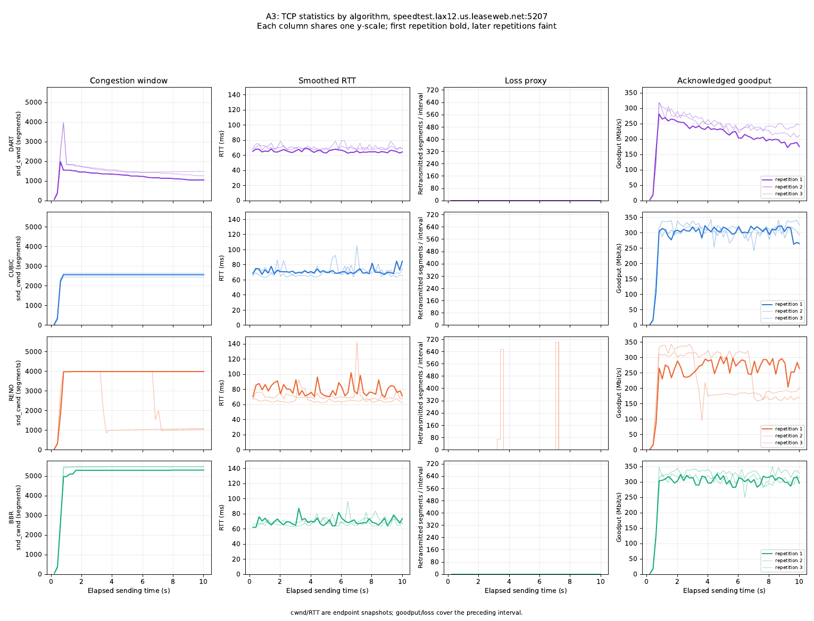
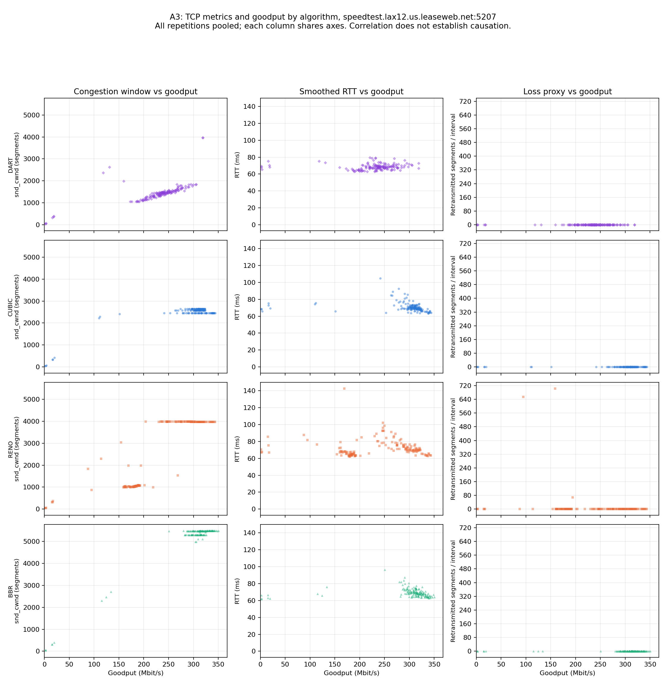
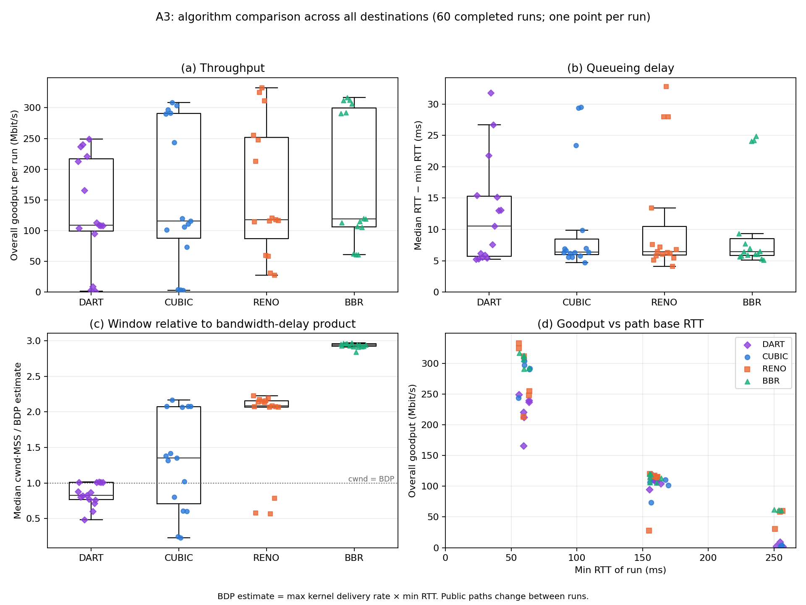

# Assignment 3: DART in eBPF (Option 1)

Repository: https://github.com/vrajpatel-18/CS422-hw3 · build/run instructions: [README.md](README.md)

## 1. Implementation

DART is a BPF `struct_ops` implementation of `tcp_congestion_ops`
([dart.bpf.c](https://github.com/vrajpatel-18/CS422-hw3/blob/main/dart/dart.bpf.c)), registered as
`dart` with `bpftool struct_ops register`. The A2 client selects it with
`setsockopt(TCP_CONGESTION, "dart")` before `connect()` and reads it back after
([tcp_stats.py `select_congestion_algorithm`](https://github.com/vrajpatel-18/CS422-hw3/blob/main/tcp_stats.py#L87-L92));
every run records `actual_algorithm`.

**How cwnd is updated.**

| Signal | Source in the kernel | Used for |
| --- | --- | --- |
| RTT | `ack_sample.rtt_us` (per ACK), `srtt_us`, `mdev_us` | `min_rtt` (10 s window), per-round minimum RTT → queued packets; STARTUP exit; loss classification |
| Throughput | `rate_delivered / rate_interval_us` (kernel delivery-rate sample) | `btl_bw` (windowed max) → BDP; STARTUP exit; CRUISE growth speed; cwnd cap |
| Loss | kernel loss detection (dup-ACK/SACK/RACK, RTO) → `ssthresh`, `set_state` hooks | multiplicative decrease, scaled by whether the queue was full; RTO restarts STARTUP |

| Hook | Lines | Role |
| --- | --- | --- |
| `dart_init` | [L106-L118](https://github.com/vrajpatel-18/CS422-hw3/blob/main/dart/dart.bpf.c#L106-L118) | initial state |
| `dart_pkts_acked` | [L120-L135](https://github.com/vrajpatel-18/CS422-hw3/blob/main/dart/dart.bpf.c#L120-L135) | RTT samples: `min_rtt`, round minimum |
| `dart_cong_avoid` | [L211-L243](https://github.com/vrajpatel-18/CS422-hw3/blob/main/dart/dart.bpf.c#L211-L243) | per ACK: delivery-rate sample, STARTUP growth, PROBE_RTT; starts a round once per `srtt` |
| `dart_round` | [L137-L209](https://github.com/vrajpatel-18/CS422-hw3/blob/main/dart/dart.bpf.c#L137-L209) | once per RTT: STARTUP / CRUISE / COMPETE rules, cap, `min_rtt` refresh |
| `dart_ssthresh` | [L245-L270](https://github.com/vrajpatel-18/CS422-hw3/blob/main/dart/dart.bpf.c#L245-L270) | once per loss episode: 0.7× if queue full, else max(0.9×, BDP) |
| `dart_set_state`, `dart_undo_cwnd` | [L272-L291](https://github.com/vrajpatel-18/CS422-hw3/blob/main/dart/dart.bpf.c#L272-L291) | RTO → STARTUP; undo spurious reductions |

Per round (every `srtt`), with `rtt` = the lowest RTT sample in the round:

```text
bdp    = btl_bw × min_rtt                               # packets
queued = cwnd × max(0, rtt − min_rtt − rttvar) / rtt    # packets in the bottleneck queue
STARTUP: cwnd += acked per ACK (doubles per RTT)
         exit if btl_bw grew < 25% for 3 rounds or rtt > min_rtt + clamp(min_rtt/8, 4, 16 ms):
         cwnd = bdp + α, → CRUISE                        (a loss also → CRUISE)
CRUISE:  queued < α → cwnd += 2 if btl_bw rising else 1;  queued > β → cwnd −= 1
         cwnd ≤ bdp + btl_bw × rttvar + 4β;  queued > β for 8 rounds → COMPETE
COMPETE: cwnd += 1;  queued < α for 4 rounds → CRUISE
min_rtt older than 10 s → PROBE_RTT: cwnd = 4 for max(200 ms, srtt), then restore
```

**Initial state.** cwnd = kernel initial window (10 segments), `ssthresh` = ∞,
mode STARTUP, `min_rtt` = ∞, `btl_bw` = 0.

**Parameters.** α = 2, β = 4 packets; minimum cwnd 4; `btl_bw` window 5–10
rounds; `min_rtt` window 10 s; PROBE_RTT 200 ms; loss cuts 0.7 / 0.9; COMPETE
after 8 rounds, back after 4.

**Changes from the A2 pseudocode.** The first three came from test runs on this
network: DART stalled at 10–30 Mbit/s while CUBIC reached ≈ 300 Mbit/s.

| Change | Why |
| --- | --- |
| Queue estimate uses the per-round **minimum** RTT, not `srtt` (as Linux Vegas does) | `srtt` sits 2–4 ms above `min_rtt` from jitter alone, which DART read as a queue |
| Delay within `rttvar` is ignored (replaces the `noisy` check); the cap gets the same allowance (`btl_bw × rttvar`) | α–β = 2–4 packets is ≈ 0.1 ms at 300 Mbit/s, far below RTT jitter; without it cwnd froze at cwnd·jitter/RTT ≈ 3 packets |
| STARTUP delay exit uses CUBIC HyStart's threshold (`min_rtt/8`, 4–16 ms) instead of `queued > β` | `queued > β` fired from jitter at ≈ 20% of the BDP |
| `btl_bw` = max of two 5-round buckets (5–10 rounds), not a sliding 10-round max | avoids variable-index array access and simplifies verification in this implementation |
| Loss episodes come from the kernel's detection via `ssthresh` (once per recovery), not Δ`total_retrans` | the kernel already detects loss; PRR then lowers cwnd to the returned target |
| RTO: the kernel sets cwnd to in-flight + 1, then DART restarts STARTUP | `cwnd = 1` in the pseudocode; same behaviour |

## 2. Environment and method

- **Host:** Ubuntu 26.04.1 (arm64) in a UTM VM on an Apple M3 Mac (Shared Network/NAT,
  Mac on Wi-Fi), kernel `7.0.0-38-generic`, clang 21.1.8, bpftool 7.7.0, Python 3.14.4.
  Build and load: [README.md](README.md).
- **Runs:** `experiment.py run -n 5 -t 10 --interval 0.2 -r 3 --seed 422` with the
  A2 server list, 2026-10-20 05:24–05:41 UTC. 5 destinations × 4 algorithms × 3
  repetitions = 60 runs of 10 s, sampled every 0.2 s, 5 s pause between tests.
  Hong Kong (A2's 2nd destination) refused twice (`ACCESS_DENIED`) and was replaced by
  `154.81.51.4`. All 60 runs completed, and `actual_algorithm` matched the request in every run.
- **Order:** repetition 1 visits each destination with dart, cubic, reno, bbr.
  Repetitions 2 and 3 rotate the order (cubic, reno, bbr, dart / reno, bbr, dart, cubic)
  and sweep all destinations, so repeats are minutes apart.
- **Logged per sample** (from `TCP_INFO`, as in A2): cwnd, sRTT, rttvar, min RTT,
  goodput from Δ`bytes_acked`, and loss = Δ`total_retrans` (retransmitted segments).

Data: [results/a3](results/a3) (`runs/*.json` and `samples.csv` are the raw data). Tables
and plots are generated by [comparison.py](comparison.py) (`plot_timeseries`,
`plot_scatter`, `plot_compare`, `comparison_tables`).

### Build, load, and reproduce on Linux

The recorded kernel is `7.0.0-38-generic` on arm64. Required features are
`CONFIG_BPF_SYSCALL`, `CONFIG_BPF_JIT`, `CONFIG_DEBUG_INFO_BTF`, kernel BTF at
`/sys/kernel/btf/vmlinux`, and BPF `struct_ops` support for `tcp_congestion_ops`.
This implementation uses `.struct_ops.link`; use a compatible kernel (6.4+ with
these features). The build generates `vmlinux.h` from the running kernel.
BBR must also be available. Commands, from the repository root:

```sh
sudo apt install clang llvm libbpf-dev bpftool make python3-venv
sudo modprobe tcp_bbr
sudo sysctl -w net.ipv4.tcp_allowed_congestion_control="reno cubic bbr"
python3 -m venv .venv
.venv/bin/pip install -r requirements.txt
make -C dart clean
make -C dart
make -C dart load
cat /proc/sys/net/ipv4/tcp_available_congestion_control
run_dir="results/a3-$(date +%Y%m%d-%H%M%S)"
.venv/bin/python experiment.py run --servers servers.csv --output "$run_dir" \
    -n 5 -t 10 --interval 0.2 -r 3 --seed 422
.venv/bin/python experiment.py plot "$run_dir"
# After all tests and sockets have finished:
make -C dart unload
```

The available list must include `dart`, `cubic`, `reno`, and `bbr` before testing.
The experiment checks that all algorithms are selectable before sending traffic.
Each invocation needs a new output directory; the submitted measurements remain
in `results/a3`. Raw JSON, CSV measurements, server configuration, and experiment
metadata are included there; Python plotting dependencies are in `requirements.txt`.
Loading needs administrator privileges and must be repeated after reboot.
The local demonstration procedure is in [DEMO.md](DEMO.md).

## 3. Results

Representative destination: `speedtest.lax12.us.leaseweb.net:5207` (min RTT ≈ 59 ms),
the same host and port as Assignment 2, Q2(b). All four algorithms (DART, CUBIC,
Reno, BBR) have three successful runs here. Each A3 run lasts 10 s with a 0.2 s
sampling interval; A2's Q2 trace lasted 20 s. A3 keeps duration and sampling
interval identical across its four algorithms.

The figures repeat all seven Q2(b) plots:

| A2 Q2(b) visualization | Metrics repeated for each of the four algorithms | A3 output |
| --- | --- | --- |
| Time series | cwnd, sRTT, loss proxy (retransmitted segments per interval), acknowledged goodput versus elapsed time | [q3-timeseries.pdf](results/a3/q3-timeseries.pdf) |
| Scatter | cwnd versus goodput, sRTT versus goodput, loss proxy versus goodput | [q3-scatter.pdf](results/a3/q3-scatter.pdf) |

Rows are labeled by algorithm. Time-series panels share the elapsed-time axis
and one y-scale per metric across all four rows. Scatter panels share the
goodput axis and one y-scale per metric across all four rows. Time series show
all three repetitions (first bold, later faint); scatter plots pool their samples.
The plotting command refreshes both the PDFs and the PNGs embedded below.





Per-destination goodput over time: [goodput.pdf](results/a3/goodput.pdf).

**Aggregate statistics** (15 runs per algorithm, from [q3-algorithms.csv](results/a3/q3-algorithms.csv)
and [q3-runs.csv](results/a3/q3-runs.csv); queueing delay = median sRTT − min RTT):

| | Run goodput, median (Mbit/s) | mean ± sd | Queueing delay, median (ms) | p95 RTT − min RTT, median (ms) | Retransmitted segments (total) |
| --- | ---: | ---: | ---: | ---: | ---: |
| DART | 108.8 | 131.7 ± 86.5 | 10.5 | 22.7 | **1117** |
| CUBIC | 115.5 | 158.1 ± 118.3 | 6.4 | 23.0 | 2600 |
| Reno | 117.5 | 163.0 ± 108.0 | 6.5 | 19.8 | 2041 |
| BBR | 119.4 | 179.6 ± 108.2 | 6.4 | 16.2 | 2484 |

**Absolute RTT aggregates** (ms, from `q3-algorithms.csv`):

| Algorithm | Median of run median sRTT | Median of run p95 sRTT |
| --- | ---: | ---: |
| DART | 167.14 | 181.58 |
| CUBIC | 162.25 | 178.48 |
| Reno | 161.66 | 168.50 |
| BBR | 161.47 | 164.82 |

Each run contributes equally: first compute its median and p95 over measured
sRTT samples, then take the median across its algorithm's 15 runs. Per-run p95
uses linear interpolation at index `(n - 1) * 0.95` in the sorted samples.
The excess-p95 column above instead subtracts each run's minimum RTT before
aggregation. Goodput mean and sample standard deviation use per-run acknowledged
goodput (8 × acknowledged payload bytes / elapsed sampling time), including startup.
The sd mostly reflects the differences between destinations.

**Mean goodput per destination** (Mbit/s, mean ± sd over 3 runs, [q3-variability.csv](results/a3/q3-variability.csv)):

| Destination | min RTT | DART | CUBIC | Reno | BBR |
| --- | ---: | ---: | ---: | ---: | ---: |
| Salt Lake City (xmission) | 55 ms | 212 ± 43 | 285 ± 36 | 323 ± 11 | 312 ± 5 |
| Los Angeles (leaseweb) | 59 ms | 230 ± 15 | 293 ± 4 | 239 ± 23 | 298 ± 12 |
| 213.158.175.240 | 155 ms | 106 ± 9 | 100 ± 24 | 88 ± 52 | 109 ± 5 |
| iperf.pendc.com | 155 ms | 107 ± 2 | 109 ± 7 | 116 ± 1 | 117 ± 4 |
| 154.81.51.4 | 250 ms | 4.5 ± 4.0 | 3.3 ± 0.7 | 50 ± 16 | 61 ± 1 |

**Observations.**

- *This network is not A2's.* Uploads reach ≈ 300 Mbit/s here (≈ 45 Mbit/s in A2), so
  the results are not comparable with A2's numbers.
- *On most paths the limit is outside congestion control.* On LAX, CUBIC and BBR keep
  a flat cwnd of 2500–5500 packets with no retransmissions, and their median cwnd is
  1.4–2.9× the BDP estimate (panel c). Growing cwnd further adds neither rate nor
  queue, so the VM, NAT, or path caps the rate at ≈ 300 Mbit/s (≈ 110 Mbit/s on the 155 ms
  paths). These measurements do not isolate the limiting component. Where algorithms reach the cap, the
  differences are within the run-to-run spread.
- *DART backs off for delay it did not cause (short paths).* RTT rises ≈ 5 ms above the
  minimum under load (Wi-Fi/NAT). DART counts the part above `rttvar` as its own queue
  and removes 1 packet per round. Its cap is set from the delivery rate, which follows
  cwnd, so the cap falls too. On LAX, cwnd falls by 330–570 packets in 9 s (e.g. 1557 → 1057) and goodput
  from 265–295 to 185–240 Mbit/s. That makes DART 20–32% slower than CUBIC and BBR on the 55–59 ms
  paths. In exchange it had no retransmissions on LAX and the lowest p95 RTT there
  (11.5 ms above the minimum against 16–17 ms). This is the main weakness of the
  design: a delay-based flow yields to any rising delay.
- *DART holds its own on the 155 ms paths* (95–113 Mbit/s) with fewer retransmissions (0 on pendc; 417 against 1172 for CUBIC and 2482 for BBR on
  213.158.175.240). Its median queueing delay there is higher (10–15 ms against 5–7 ms). DART does not
  explicitly control pacing. A possible explanation is a queue that fills and empties
  within each round: the per-round *minimum* RTT (change 1) can miss such a queue.
  This would underestimate backlog and help explain why DART sits at its cap
  (≈ 1930 packets in every run).
- *Delay-based startup exits hurt on the 250 ms path.* DART and CUBIC (with HyStart)
  both left slow start at cwnd 30–64, because RTT on this path swings by more than
  the 16 ms threshold. A 10 s test has only ≈ 40 rounds at 250 ms, so neither recovered
  (2–9 Mbit/s). Reno and BBR have no delay exit and reached ≈ 4000–5600 packets
  (50–61 Mbit/s). The short tests exaggerate how much startup matters.
- *Loss.* DART retransmitted the least: 1117 segments against 2041–2600, and zero in 9 of 15 runs.
  Its loss response worked as designed: no loss episode collapsed its window.
- *Not exercised:* PROBE_RTT (needs a 10 s stale `min_rtt`, so it cannot fire in a 10 s test)
  and fairness between competing flows (one flow per test).

## 4. Limitations

One flow per test on public paths and Wi-Fi, with uncontrolled cross traffic. The
BDP estimate (max delivery rate × min RTT) is approximate. DART's parameters were tuned only enough
to fix the jitter problem described in Section 1. Three runs per cell detect only
large differences.

## 5. AI acknowledgement

We used Claude Code (Anthropic) to set up the VM toolchain, write `dart.bpf.c` and
the Makefile from our A2 pseudocode, debug DART with `bpf_printk` traces (which found
the jitter problem and led to the changes in Section 1), run the experiments, and draft
this report. We reviewed the code and results and can explain each part.

OpenAI Codex subsequently audited the saved measurements against the assignment,
added explicit absolute RTT aggregates and reproduction instructions, corrected
report wording. Codex did not rerun the Linux kernel build or the
network experiments in the macOS workspace.
